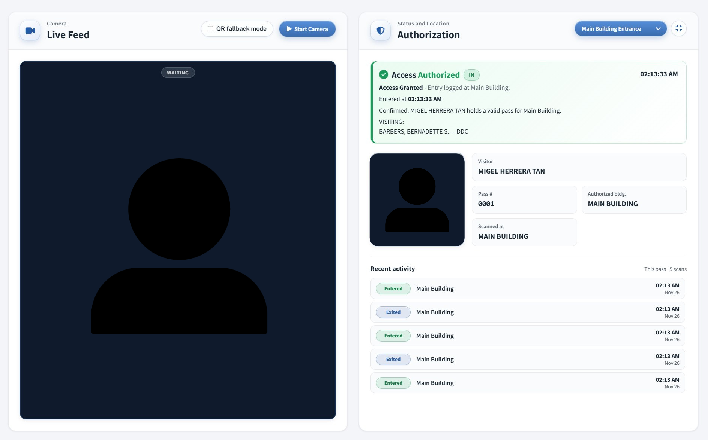
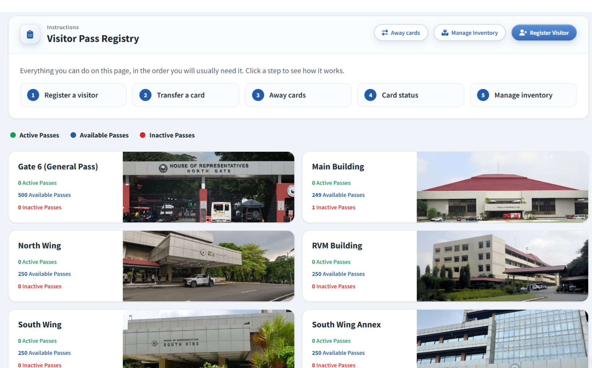
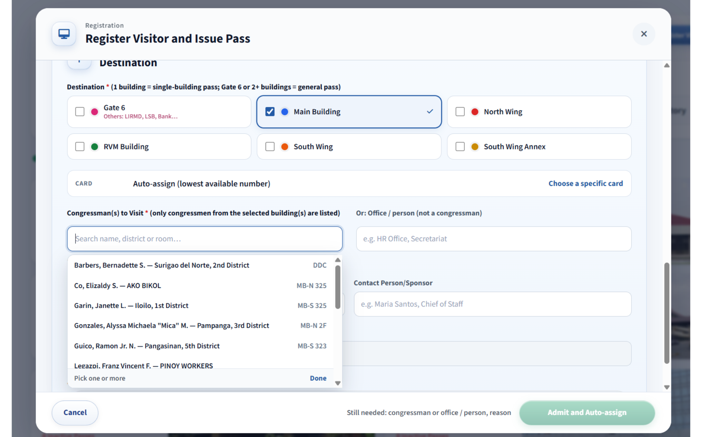
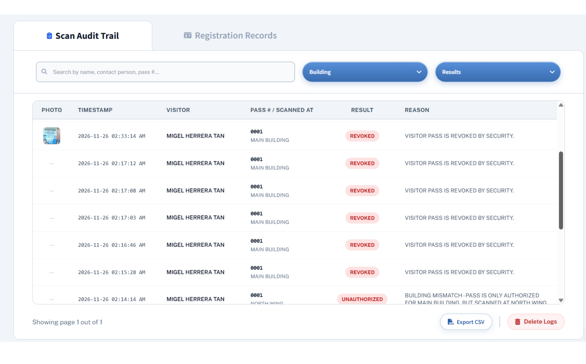
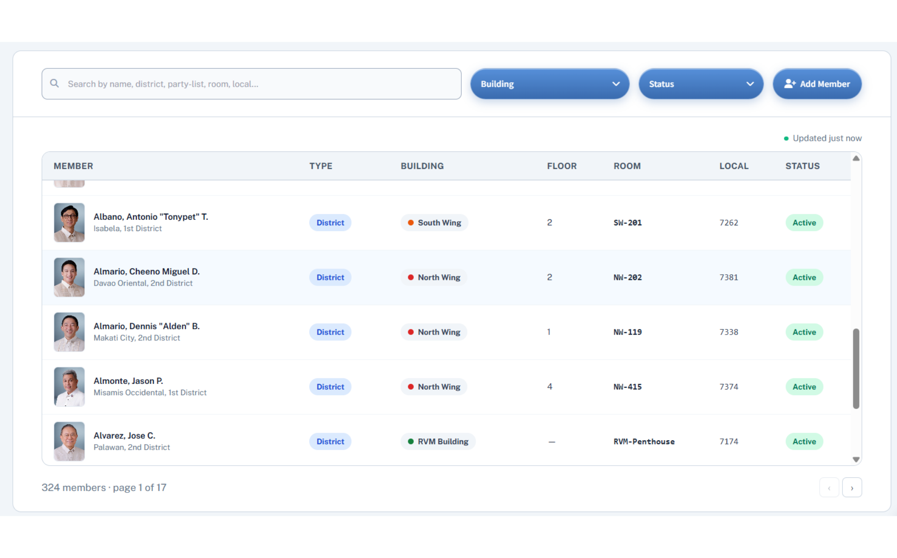
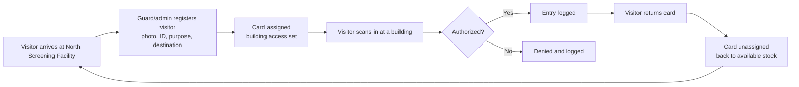
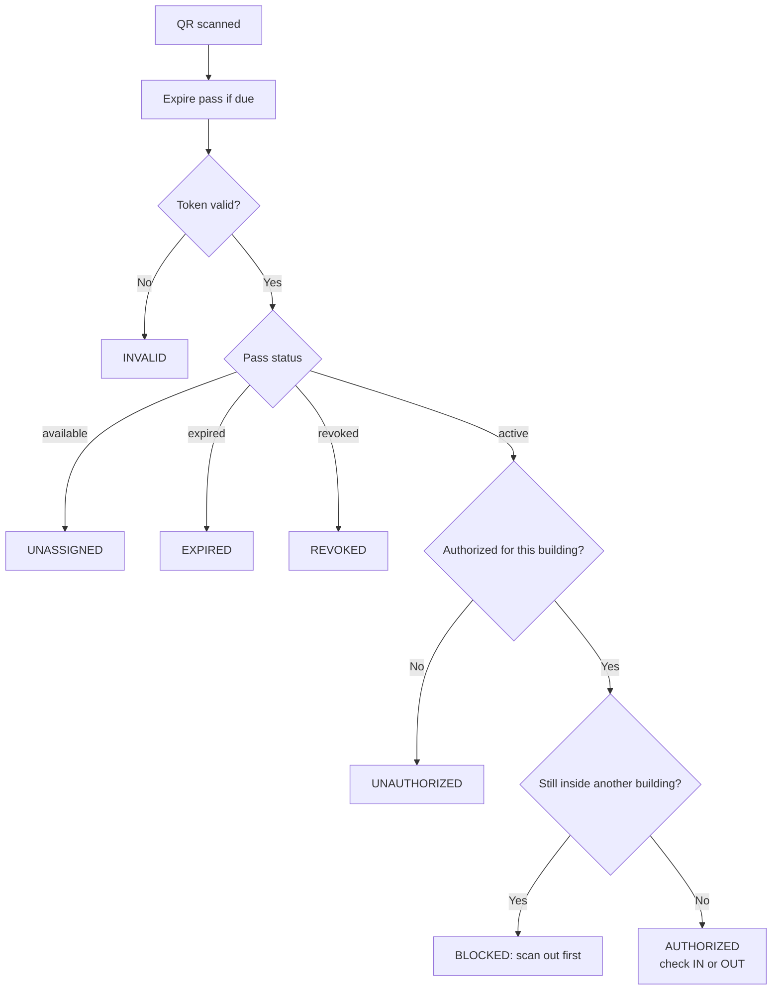

<div align="center">

# HouseGate QR

**QR-based visitor building access control and monitoring for the House of Representatives of the Philippines**

Office of the Sergeant at Arms, Legislative Security Bureau (Perimeter Security Group)

Built by **Migel H. Tan** during the **INSPIRE Internship Program** (formerly SMART Internship Program)

</div>

---

## Introduction

Visitors to the House of Representatives complex are issued physical, color-coded cards, one color per building, and security personnel check them by eye against a paper logbook. Nothing automatically catches a visitor who is authorized for one building trying to walk into another, and there is no searchable record of who went where.

HouseGate replaces that manual check with a simple mechanism: every physical card carries a unique **QR token**. A guard scans it at a building entrance and the system answers instantly (`AUTHORIZED`, `UNAUTHORIZED`, `BLOCKED`, `EXPIRED`, `REVOKED`, `UNASSIGNED` or `INVALID`) while writing every attempt, successful or not, to a central audit trail.

It is designed to **supplement** existing guards and physical passes, not replace them.

> **Status:** working prototype. It is built to a standard where real use is plausible, but it has not been through a production hardening or security review. See [Known limitations](#known-limitations).

---

## Project Resources

| Resource         | Link                                                                         |
| ---------------- | ---------------------------------------------------------------------------- |
| Video demo       |                                                             |
| Project document |                                                           |
| Source code      | [github.com/migeltan/HouseGate-QR](https://github.com/migeltan/HouseGate-QR) |

---

## Screenshots

> Add images to `docs/screenshots/` using the file names below, or change the paths.

| Login                                | Scanner (AUTHORIZED result)                         |
| ------------------------------------ | --------------------------------------------------- |
|  |  |

| Pass registry                                 | Register visitor (modal)                                 |
| --------------------------------------------- | -------------------------------------------------------- |
|  |  |

| Audit logs                         | Congressman directory                        |
| ---------------------------------- | -------------------------------------------- |
|  |  |

| Printable QR pass                                | Admin: users and inventory           |
| ------------------------------------------------ | ------------------------------------ |
|  |  |

---

## About the Project

### The problem

- Access control relies on guards visually matching a card color to a building.
- A visitor authorized for one building can try another, and only a sharp-eyed guard stops them.
- Records live in a paper logbook: slow to write, impossible to search, easy to lose.
- Expired passes, missing visitors and "who visited whom" questions are hard to answer after the fact.

### What HouseGate does

- Gives every physical card a unique QR token and tracks its full lifecycle.
- Validates a scan against the pass's status, authorized buildings and current in/out state in a single step.
- Captures visitor, ID and (optionally) live verification photos.
- Records the congressman or office each visitor is going to.
- Tracks which desk physically holds each card, and which cards and IDs are still out after a transfer.
- Keeps a permanent, searchable, exportable audit trail of every scan, registration and admin action.

### Buildings and card colors

| Code | Building              | Card color |
| ---- | --------------------- | ---------- |
| NW   | North Wing            | Red        |
| SW   | South Wing            | Orange     |
| RVM  | RVM Building          | Green      |
| MB   | Main Building         | Blue       |
| SWA  | South Wing Annex      | Yellow     |
| NG   | Gate 6 (General Pass) | Pink       |
| OTH  | Others (no cards)     | Gray       |

- **Gate 6** is the **multi-building pass**: one card valid at any mix of the five buildings and/or Others. It is never a destination or a scanning station of its own. Only admins can issue or edit these passes. (The database code stays `NG` from its earlier name, North Gate.)
- **Others** is a single destination category for offices and people outside the five buildings (for example LSB or a bank). It has no card pool: a visitor going to Others is issued a Gate 6 pass, with an optional "which place" note kept in the logs. Guards can sign in to an Others station to scan, but registering visitors there is admin-only for now.

---

## How It Works

### The visitor loop



### What happens on every scan



Every outcome, including denials, is written to `scan_logs` with a snapshot of the visitor, pass, authorized buildings and contact person at that moment.

### Pass lifecycle

`available` → `active` → `expired` or `revoked`. Returning a card **unassigns** it, which sends it back to `available`.

| Pass type          | Expires                                                                              |
| ------------------ | ------------------------------------------------------------------------------------ |
| **Day pass**       | At the first 19:00 after issue                                                       |
| **Long-term pass** | End of the expected return date, which can be at most **7 calendar days** from today |

Expiry is enforced on every scan, every 5 minutes by a scheduled command, and by a nightly sweep at 19:00.

### Unassign, revoke and hold

- **Unassign** (card returned): wipes the visitor's data and their visitor and ID photos from the pass, detaches its buildings and sends it back to stock. History is kept in `pass_registrations`.
- **Revoke**: only flips the status so scans return `REVOKED`. Visitor data is kept for audit.
- **Hold**: takes a blank card out of circulation as `missing`, `damaged` or `other`. If it is scanned anyway, the result is `UNASSIGNED` with the hold reason, so the guard knows to call a supervisor.

### Card custody and transfers

Every card has a **holder desk** (a card held by no desk is in the vault). Guards can only issue cards that are in their own desk's stock, and admins move stock between the vault and desks from the inventory tools. A desk is warned when it holds fewer than 50 blank cards.

When a visitor moves to a different building, the system **transfers** them to a card for that building:

- The old registration is closed as `transferred` and linked to the new one.
- The old card is held at the desk that issued the new one, to be handed back to its home desk.
- The visitor's ID stays at the desk where it was surrendered until it is marked returned.
- The **Away cards** panel lists every card and ID still out. Anything away for more than 12 hours is flagged as overdue. The panel updates live without a page reload.

### Roles

| Capability                                                    | Guard                                 | Admin        |
| ------------------------------------------------------------- | ------------------------------------- | ------------ |
| Log in with HREP ID, password and role                        | Yes                                   | Yes          |
| Building                                                      | Locked to one building per session    | Any          |
| Scan visitors                                                 | Own building                          | Any building |
| Register, unassign, revoke, hold, transfer passes             | Own building's single-building passes | All passes   |
| Issue or edit Gate 6 multi-building passes                    | No                                    | Yes          |
| Register visitors at the Others station                       | No (scan only)                        | Yes          |
| Away cards (hand back cards and IDs)                          | Own desk                              | All desks    |
| Pass inventory (generate, stock, print, CSV, print templates) | No                                    | Yes          |
| Congressman directory edits                                   | View only                             | Yes          |
| Manage users (create, edit, reset password, deactivate)       | No                                    | Yes          |
| View logs                                                     | Own building's scans                  | All          |
| Purge scan logs, view the admin activity log                  | No                                    | Yes          |
| Edit own profile and password                                 | Yes                                   | Yes          |

Deactivated users are logged out immediately.

---

## Key Features

**Registration**

- Three-step modal: camera capture, visitor information, destination.
- Purpose from a fixed list (Official Business, Financial/Medical Assistance, Visit, Others).
- Destination chosen from the congressman roster (limited to the selected building(s)) and/or another office or person. Contact person and vehicle details are recorded too.
- Cards are auto-assigned, or a specific card can be picked from the desk's in-stock cards.
- Duplicate detection: an active pass held by the same person (matched on ID, or on name and contact number) is caught, and the guard can transfer them to a new card instead.
- **Pass transfer**: a visitor can swap cards while keeping their identity. Their details and photos carry over unless new ones are captured.

**Scanning**

- Honeywell keyboard-wedge 2D scanner, webcam scanning, or manual token entry.
- Instant result with the visitor's photo and who they are visiting.
- Optional live verification photo at the moment of each scan.
- In/out occupancy tracking. Stale occupancy (more than 16 hours) is treated as a fresh entry.

**Administration**

- Pass inventory: generate stock per building (numbers 1 to 250 by default, existing numbers are skipped), distribute it between the vault and desks, and export CSV.
- Printing: QR-only and paper-print layouts, with saved print templates.
- Congressman directory with add, edit, deactivate and reactivate, including floor, room, trunk line, local and direct numbers, remarks and photo.
- User management with activation control, plus a self-service page for your own profile and password.
- Admin activity log (`admin_logs`).
- "What's New" release notes modal, edited in `config/whatsnew.php`.

**Modals and live updates (no page reloads)**

- **Register Visitor**: the three-step registration flow described above.
- **Building passes**: browse and search every pass of a building from the Passes page.
- **Pass info**: a pass's visitor, destination and status details.
- **Pass QR**: view or print a pass's QR code.
- **Away cards**: cards and IDs still to be handed back.
- **Pass inventory** (admin): generate, stock, print and export.
- The Away cards panel and the logs refresh through one lightweight poll (`/live/pulse`).

**Offline congressman directory**

- The directory keeps working without a connection, so guards can still look up a member and their office.
- The member list is stored in the browser and refreshed in the background with a cheap version check, so it only re-downloads when the roster actually changed.
- A service worker caches the directory page, its styles, fonts, icons and member photos for full offline reloads. This part needs HTTPS or `localhost`. On plain `http://` the page still works online, and the cached member list still helps, but a reload with no connection will not.
- Editing the directory (admin) only works while online.
- A separate app-wide service worker caches static assets (CSS, JS, fonts, images) only, never pages or photos.

**Audit and records**

- `scan_logs` (with verification photos), `pass_registrations` (append-only history) and `admin_logs`.
- Searchable logs with CSV export; admin-only purge of scan logs behind a typed confirmation.

**Photo privacy**

- Visitor, ID and verification photos live on a private `photos` disk with no public URL. They are served only through login-protected, throttled `/photos/...` routes.

**Reminders**

- Daily "still checked in" reminder and a long-term "expiring soon" reminder, sent only if the visitor gave an email. Mail is queued.

---

## Tech Stack

| Layer                  | Technology                                                                                        |
| ---------------------- | ------------------------------------------------------------------------------------------------- |
| Backend                | Laravel 12, PHP 8.3+                                                                              |
| Views                  | Blade (server-rendered, plain JS inline in views, no SPA)                                         |
| Database               | MySQL (SQLite also works for local development and is used by the tests)                          |
| Styling                | Committed `public/css/tailwind.css` (Tailwind 3 CLI build) plus page stylesheets in `public/css/` |
| Fonts and icons        | Self-hosted under `public/fonts` and `public/vendor/fontawesome`                                  |
| QR generation          | `endroid/qr-code`                                                                                 |
| QR scanning            | `html5-qrcode` (loaded from the unpkg CDN), USB keyboard-wedge scanner, manual entry              |
| Sessions, cache, queue | `database` drivers                                                                                |
| Testing                | PHPUnit feature tests via `php artisan test` (Pest is installed; coverage is small)               |

> Vite 8 and Tailwind 4 are still scaffolded (`vite.config.js`, `resources/css/app.css`), but no view loads them, so `npm run build` is not needed to run the app.

---

## Setup

**Requirements:** PHP 8.3+, Composer, and MySQL (or SQLite). Node.js is only needed if you change Tailwind classes.

```bash
git clone https://github.com/migeltan/HouseGate-QR.git
cd HouseGate-QR/housegate        # the Laravel app lives in this folder; run every command below from here

composer install
cp .env.example .env
php artisan key:generate
```

Set your `DB_*` values in `.env` (or keep `DB_CONNECTION=sqlite` and run `touch database/database.sqlite`), then:

```bash
php artisan migrate
php artisan db:seed          # admin account, buildings, starter passes and the congressman roster
php artisan storage:link     # only needed for congressman directory photos
```

> `public/css/tailwind.css` is committed. Only run `npm install && npm run build:css` if you change Tailwind classes in the views.

### Environment

| Variable                     | Notes                                                                                                                      |
| ---------------------------- | -------------------------------------------------------------------------------------------------------------------------- |
| `APP_URL`                    | Must match the URL people actually open. Every generated URL (redirects, assets, directory photos) is built from it.       |
| `PHOTOS_DISK_ROOT`           | Optional. Where visitor, ID and verification photos are stored. Defaults to `storage/app/private/photos`.                  |
| `MAIL_*`, `QUEUE_CONNECTION` | Reminders are queued (`database`) and the default mailer is `log`. See [Reminders](#key-features) and [Running](#running). |

### Demo accounts

`UserSeeder` creates a single administrator (HREP ID `00012`) with a randomly generated password, printed once in the console when the seeder runs. No password is stored in the repository. Sign in, change it, then create every other account (guards, additional admins) from the Users page. Re-running the seeder never changes an existing account.

---

## Running

```bash
php artisan serve              # or serve the project through Laravel Herd
php artisan schedule:work      # pass expiry every 5 min, daily sweep at 19:00
php artisan queue:work         # sends queued reminder emails
```

- Passes are also expired on every scan, so scanning is correct even if the scheduler is not running.
- `MAIL_MAILER=log` by default, so reminders are written to `storage/logs/laravel.log` instead of being delivered. Configure a real mailer to send them.

### Useful commands

```bash
php artisan passes:expire                         # expire due passes now
php artisan passes:daily-sweep                    # run the nightly sweep manually (also queues reminders)
php artisan passes:generate NW --from=1 --to=250  # create card numbers for one building (omit the code for all)
php artisan passes:seed-multi 5                   # sample Gate 6 passes for testing
php artisan db:seed --class=CongressmanSeeder     # reload the roster from database/data/congressmen.csv
php artisan congressmen:import-phones             # fill trunk line / local / direct from the CSV (--overwrite to replace)
php artisan congressmen:import-photos             # match photos in database/data/photos to members
php artisan photos:migrate-private --run          # one-off: move old public-disk visitor photos to the private disk
php artisan optimize:clear                        # clear cached config, routes and views
php artisan test                                  # run the tests
```

---

## Demo Deployment (multiple devices, different networks)

To demo from other laptops and phones on different networks without hosting anything, run the app on one machine and expose it through an HTTPS tunnel (ngrok). **HTTPS is required:** browsers only allow camera access on HTTPS or `localhost`, and both registration and scanning use the camera.

### Already handled in the code

- `bootstrap/app.php` calls `trustProxies(at: '*')`, so Laravel generates `https://` URLs behind the tunnel.
- `AppServiceProvider` forces the root URL to `APP_URL`. A tunnel that rewrites the Host header would otherwise make Laravel redirect to your local `.test` address.

### One-time setup

1. **Laravel Herd only:** serve the site over plain HTTP with `herd unsecure`. A secured site makes Herd's nginx redirect every request to `https://<site>.test`, which other devices cannot reach.
2. **Set `.env`** to match your tunnel URL, then run `php artisan config:clear`:
   ```dotenv
   APP_URL=https://<your-domain>.ngrok-free.dev
   APP_DEBUG=false
   SESSION_SECURE_COOKIE=true
   ```
3. **Storage link:** run `php artisan storage:link` once (needed for directory photos).
4. **ngrok:** install it, add your auth token, and find your free dev domain in the ngrok dashboard under Domains.

### Every demo: run these three terminals

With Herd already serving the site, open three terminals in the `housegate` folder:

```bash
# Terminal 1: the tunnel (replace the domain and the Herd site name)
ngrok http 80 --url=gainfully-strum-viewpoint.ngrok-free.dev --host-header=housegate.test

# Terminal 2: scheduler (pass expiry every 5 minutes, daily sweep at 19:00)
php artisan schedule:work

# Terminal 3: queue worker (reminder emails)
php artisan queue:work
```

Without Herd, run `php artisan serve` and tunnel to its port instead (`ngrok http 8000 --url=...`, no `--host-header` needed). Note that `php artisan serve` handles one request at a time on Windows.

Then open `https://gainfully-strum-viewpoint.ngrok-free.dev` on any device. On the free ngrok plan, each new browser shows a one-time warning page: click **Visit Site**.

### Before you present

- Only one tunnel can use a domain at a time. Stop any other ngrok session that uses it.
- Keep the host machine plugged in with sleep disabled, and keep a phone hotspot as backup.
- Use fake visitor data. Registration stores photos of the visitor and their ID.
- Log in on each device once before the demo and allow camera access when asked.

### Troubleshooting

| Symptom                                                           | Likely cause and fix                                                                                                                                |
| ----------------------------------------------------------------- | --------------------------------------------------------------------------------------------------------------------------------------------------- |
| Browser jumps to `<site>.test` and says the server can't be found | The site is secured in Herd (run `herd unsecure`), or the browser cached the old redirect. Open the URL in a private tab or clear that site's data. |
| ngrok says the endpoint is already online                         | Another tunnel is using the same domain. Stop it.                                                                                                   |
| Page loads unstyled, or images and directory photos are broken    | `APP_URL` does not match the URL you opened (run `php artisan config:clear` after changing it), or the storage link is missing.                     |
| Camera does not start                                             | The page is not on HTTPS, or camera permission was denied in the browser.                                                                           |
| Webcam scanner does not load                                      | The scanner library comes from a CDN, so the device needs internet access. The USB scanner and manual entry still work.                             |

> A laptop with a tunnel is a demo setup, not a deployment. For real use, host it on a proper server, ideally inside the LSB network, with HTTPS (still required for the camera). Point the web server's document root at `housegate/public`, not the repository root.

---

## Project Structure

The repository root holds only README.md, CLAUDE.md and docs/. The Laravel app lives in housegate/, and every path and command in this README is relative to that folder.

```
app/
  Console/Commands/   ExpirePasses, DailyPassSweep, GeneratePasses, GenerateMultiBuildingPasses,
                      ImportCongressmanPhones, ImportCongressmanPhotos, MigratePrivatePhotos
  Http/Controllers/   Auth, BuildingSelect, Scanner, Pass, PassInventory, Log, Congressman,
                      Account, SensitivePhoto, LivePulse, WhatsNew, DirectoryServiceWorker
  Http/Middleware/    EnsureAdmin, EnsureBuildingSelected
  Models/             VisitorPass, PassRegistration, ScanLog, ScanVerificationPhoto, Building,
                      Congressman, User, AdminLog, PrintTemplate
  Services/           PassGenerator (tokens), PhotoResizer, AwayCards, PassesLive
  Mail/               MissingEgressReminder, PassExpiringSoon
config/               whatsnew.php (release-notes popup), filesystems.php (private `photos` disk)
database/
  migrations/         schema history
  seeders/            admin user, buildings, starter passes, congressmen
  data/               congressmen.csv
resources/views/      scanner, passes (registry, registration steps, away cards), logs,
                      congressmen (directory), account, auth, layouts, emails
public/               css/ (page stylesheets + committed tailwind.css), app-sw.js, fonts, vendor
routes/               web.php, console.php (schedule)
scripts/              optimize-images.mjs (one-off image optimizer)
tests/                feature tests
```

### Pass tokens

Tokens look like `HOR-20TH-{BUILDING}-{NNNN}-{HMAC}`. The trailing checksum is an HMAC keyed on `APP_KEY`, so a token cannot be guessed from a card number. Stock generated from the inventory tools (or `passes:generate`) uses these tokens, 250 cards per building by default.

---

## Known Limitations

This is a prototype. Be aware of the following before any real deployment:

- **Photos:** visitor, ID and scan verification photos are private (no public URL) but **not encrypted** on disk. Any signed-in admin or guard can open any photo, regardless of building. Unassigning a pass deletes its visitor and ID photos, but scan verification photos remain for audit.
- **Seeded demo passes:** `DatabaseSeeder` creates 5 starter cards per building with a static, guessable token suffix (`SEC2026`). Gate 6 cards created on demand at registration, or by `passes:seed-multi`, use a guessable `PASS-MULTI-NNNN` token. Generate real stock through the pass inventory (or `passes:generate`) before production use.
- **Login hardening:** sign-in is rate-limited to 5 failed attempts per 5 minutes per HREP ID and IP address, and 30 per IP (stored in the cache). There is still no self-service password reset (admins reset passwords for users) and no forced password change on first login. The client IP comes from forwarded headers (`trustProxies` is `*`), so restrict it to HREP's proxy addresses in production.
- **Tests:** only three small feature tests exist (login page loads, console commands are registered, private photo routes are protected). Scan decisions, expiry, transfers and role scoping are verified through manual runs.
- **Webcam scanner needs internet:** `html5-qrcode` is loaded from a CDN. On a network with no internet, use the USB scanner or manual entry, or self-host the library.
- **Linux hosting:** folder names must match their namespaces exactly (`app/Console/Commands/`). After deploying, run `composer dump-autoload -o --strict-psr` and `php artisan schedule:list`. The scheduler needs a cron entry (`* * * * * cd /path/to/HouseGate-QR/housegate && php artisan schedule:run >> /dev/null 2>&1`), and `php artisan queue:work` needs a supervisor or systemd service. Without them, pass expiry sweeps and reminder emails will not run.
- **Email:** reminders are queued and the default mailer only logs. Nothing is delivered without a queue worker and a configured mailer.
- **Day-pass expiry** is time-based (19:00), not tied to a scan-out. A visitor still inside is cleared by the sweep.
- **Cards that never come back:** a card handed over but never scanned back stays "away" with its ID outstanding. The Away cards list and the 12-hour overdue flag are the only safeguard.
- **Data privacy:** the system handles visitor identities and ID photos. Any real use needs review under the Data Privacy Act of 2012.

---

## Roadmap

- Pass tracking across buildings: one view of where a visitor has been during their visit.
- Reduce the weight of the passes page (large inline view, rows for every building).
- Snapshot the visit destination (congressman or office) into `scan_logs`; only the contact person is captured there today.
- Self-host `html5-qrcode` so webcam scanning works without internet.
- Government ID scanning to pre-fill visitor details at registration (decode MRZ/QR codes where present, otherwise local OCR; on-premise first because of privacy).
- A real test suite: scan decisions, expiry, custody and transfers, role scoping and the congressman building rule.

---

## Credits

Built by **Migel H. Tan** for the **Legislative Security Bureau, Perimeter Security Group**, Office of the Sergeant at Arms, House of Representatives of the Philippines, as part of the **INSPIRE Internship Program**.
