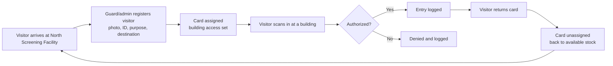
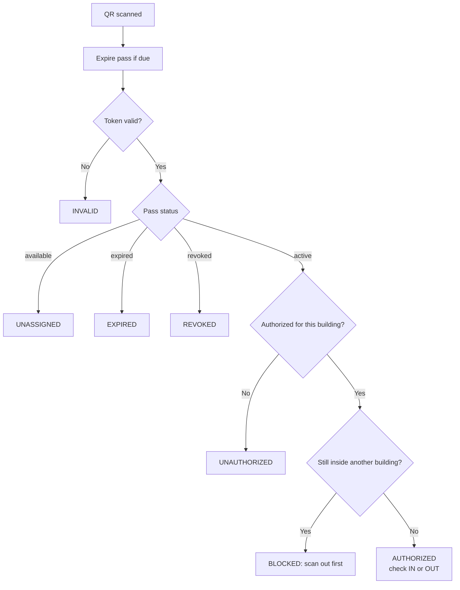

<div align="center">

# HouseGate

**QR-based visitor building access control and monitoring for the House of Representatives of the Philippines**

Legislative Security Bureau (LSB) · Perimeter Security Group · Office of the Sergeant at Arms

Built by **Migel H. Tan** during the **INSPIRE Internship Program** (formerly SMART Internship Program)

</div>

---

## Introduction

Visitors to the House of Representatives complex are issued physical, color-coded cards, one color per building, and security personnel check them by eye against a paper logbook. Nothing automatically catches a visitor who is authorized for one building trying to walk into another, and there is no searchable record of who went where.

HouseGate replaces that manual check with a simple mechanism: every physical card carries a unique **QR token**. A guard scans it at a building entrance and the system answers instantly (`AUTHORIZED`, `UNAUTHORIZED`, `BLOCKED`, `EXPIRED`, `REVOKED`, `UNASSIGNED` or `INVALID`) while writing every attempt, successful or not, to a central audit trail.

It is designed to **supplement** existing guards and physical passes, not replace them.

> **Status:** working prototype. It is built to a standard where real use is plausible, but it has not been through a production hardening or security review. See [Known limitations](#known-limitations).

---

## Project Resources

| Resource         | Link                                                                         |
| ---------------- | ---------------------------------------------------------------------------- |
| Video demo       | _Add link here_                                                              |
| Project document | _Add link here_                                                              |
| Source code      | [github.com/migeltan/HouseGate-QR](https://github.com/migeltan/HouseGate-QR) |

---

## Screenshots

> Add images to `docs/screenshots/` using the file names below, or change the paths.

| Login                                | Scanner (AUTHORIZED result)                         |
| ------------------------------------ | --------------------------------------------------- |
|  |  |

| Pass registry                                 | Register visitor (modal)                                 |
| --------------------------------------------- | -------------------------------------------------------- |
|  |  |

| Audit logs                         | Congressman directory                        |
| ---------------------------------- | -------------------------------------------- |
|  |  |

| Printable QR pass                                | Admin: users and inventory           |
| ------------------------------------------------ | ------------------------------------ |
|  |  |

---

## About the Project

### The problem

- Access control relies on guards visually matching a card color to a building.
- A visitor authorized for one building can try another, and only a sharp-eyed guard stops them.
- Records live in a paper logbook: slow to write, impossible to search, easy to lose.
- Expired passes, missing visitors and "who visited whom" questions are hard to answer after the fact.

### What HouseGate does

- Gives every physical card a tamper-resistant QR token and tracks its full lifecycle.
- Validates a scan against the pass's status, authorized buildings and current in/out state in a single step.
- Captures visitor, ID and (optionally) live verification photos.
- Records the congressman or office each visitor is going to.
- Keeps a permanent, searchable, exportable audit trail of every scan, registration and admin action.

### Buildings and card colors

| Code | Building                       | Card color |
| ---- | ------------------------------ | ---------- |
| NW   | North Wing                     | Red        |
| SW   | South Wing                     | Orange     |
| RVM  | RVM Building                   | Green      |
| MB   | Main Building                  | Blue       |
| SWA  | South Wing Annex               | Yellow     |
| NG   | North Gate (multi-access pass) | Pink       |

North Gate is the **multi-building pass**: one card authorized for several buildings at once. It is never selectable as a destination.

---

## How It Works

### The visitor loop



### What happens on every scan



Every outcome, including denials, is written to `scan_logs` with a snapshot of the visitor, pass and building at that moment.

### Pass lifecycle

`available` → `active` → `expired` or `revoked`. Returning a card **unassigns** it, which sends it back to `available`.

| Pass type          | Expires                                                                                                       |
| ------------------ | ------------------------------------------------------------------------------------------------------------- |
| **Day pass**       | At the first 19:00 after issue                                                                                |
| **Long-term pass** | End of the expected return date, maximum 30 **working days** (HOR works a compressed Monday to Thursday week) |

Expiry is enforced on every scan, every 5 minutes by a scheduled command, and by a nightly sweep at 19:00.

### Unassign vs. revoke

- **Unassign** (card returned): wipes the visitor's data and photos from the pass, detaches its buildings and sends it back to stock. History is kept in `pass_registrations`.
- **Revoke**: only flips the status so scans return `REVOKED`. Visitor data is kept for audit.

### Roles

| Capability                                              | Guard                                 | Admin        |
| ------------------------------------------------------- | ------------------------------------- | ------------ |
| Log in with HREP ID, password and role                  | Yes                                   | Yes          |
| Building                                                | Locked to one building per session    | Any          |
| Scan visitors                                           | Own building                          | Any building |
| Register, unassign, revoke, transfer passes             | Own building's single-building passes | All passes   |
| Issue or edit North Gate multi-building passes          | No                                    | Yes          |
| Pass inventory (generate, print, stock)                 | No                                    | Yes          |
| Congressman directory edits                             | View only                             | Yes          |
| Manage users (create, edit, reset password, deactivate) | No                                    | Yes          |
| View logs / purge logs / admin activity log             | View logs                             | All          |

Deactivated users are logged out immediately.

---

## Key Features

**Registration**

- Three-step modal: camera capture, visitor information, destination.
- Purpose from a fixed list (Official Business, Financial/Medical Assistance, Visit, Others).
- Destination chosen from the congressman roster (limited to the selected building(s)) and/or another office.
- Duplicate detection: an exact ID match with an active pass blocks the registration; a fuzzy match requires explicit confirmation.
- **Pass transfer**: a visitor can swap cards while keeping their identity, and the old registration is closed as `transferred`.

**Scanning**

- Honeywell keyboard-wedge 2D scanner, webcam scanning, or manual token entry.
- Instant result with the visitor's photo and who they are visiting.
- Optional live verification photo at the moment of each scan.
- In/out occupancy tracking. Stale occupancy (more than 16 hours) is treated as a fresh entry.

**Administration**

- Pass inventory: generate stock, print sheets of QR passes, CSV export.
- QR-only and paper-print layouts.
- Congressman directory with add, edit, deactivate and reactivate.
- User management with activation control.
- "What's New" release notes modal.

**Modals (no page reloads)**

- **Register Visitor**: the three-step registration flow described above.
- **Building passes**: browse and search every pass of a building from the Passes page.
- **Pass info**: a pass's visitor, destination and status details.
- **Pass QR**: view or print a pass's QR code.
- **Pass inventory** (admin): generate, print and stock passes.

**Offline congressman directory**

- The directory keeps working without a connection, so guards can still look up a member and their office.
- The member list is stored in the browser and refreshed in the background with a cheap version check, so it only re-downloads when the roster actually changed.
- A service worker caches the directory page, its styles, fonts, icons and member photos for full offline reloads. This part needs HTTPS or `localhost`. On plain `http://` the page still works online, and the cached member list still helps, but a reload with no connection will not.
- Editing the directory (admin) only works while online.

**Audit and records**

- `scan_logs` (with verification photos), `pass_registrations` (append-only history) and `admin_logs`.
- Searchable logs with CSV export; admin-only purge of scan logs behind a typed confirmation.

**Reminders**

- Daily "still checked in" reminder and a long-term "expiring soon" reminder, sent only if the visitor gave an email. Mail is queued.

---

## Tech Stack

| Layer                  | Technology                                                                            |
| ---------------------- | ------------------------------------------------------------------------------------- |
| Backend                | Laravel 12, PHP 8.3+                                                                  |
| Views                  | Blade (server-rendered, plain JS inline in views, no SPA)                             |
| Database               | MySQL (SQLite also works for local development)                                       |
| Styling and assets     | Vite 8 with Tailwind CSS 4, plus a Tailwind 3 CLI build for `public/css/tailwind.css` |
| QR generation          | `endroid/qr-code`                                                                     |
| QR scanning            | Browser webcam (`getUserMedia`), USB scanner, manual entry                            |
| Sessions, cache, queue | `database` drivers                                                                    |
| Testing                | Pest / PHPUnit (scaffold only)                                                        |

---

## Setup

**Requirements:** PHP 8.3+, Composer, Node.js and npm, and MySQL (or SQLite).

```bash
git clone https://github.com/migeltan/HouseGate-QR.git
cd HouseGate-QR

composer install
cp .env.example .env
php artisan key:generate
```

Set your `DB_*` values in `.env` (or `DB_CONNECTION=sqlite` and `touch database/database.sqlite`), then:

```bash
php artisan migrate
php artisan db:seed          # users, buildings, passes and the congressman roster
php artisan storage:link     # makes uploaded photos viewable

npm install
npm run build
```

> `public/css/tailwind.css` is committed. Only run `npm run build:css` if you change Tailwind classes.

### Demo accounts

`UserSeeder` creates one admin and one guard account (see `database/seeders/UserSeeder.php`). **Change both passwords immediately after seeding.**

---

## Running

```bash
php artisan serve              # or serve the project through Laravel Herd
php artisan schedule:work      # pass expiry every 5 min, daily sweep at 19:00
php artisan queue:work         # sends queued reminder emails
```

- Passes are also expired on every scan, so scanning is correct even if the scheduler is not running.
- `MAIL_MAILER=log` by default, so reminders are written to `storage/logs/laravel.log` instead of being delivered. Configure a real mailer to send them.

### Useful commands

```bash
php artisan passes:expire                       # expire due passes now
php artisan passes:daily-sweep                  # run the nightly sweep manually
php artisan db:seed --class=CongressmanSeeder   # reload the roster from database/data/congressmen.csv
php artisan optimize:clear                      # clear cached config, routes and views
```

---

## Demo Deployment (multiple devices, different networks)

To demo from other laptops and phones on different networks without hosting anything, run the app on one machine and expose it through an HTTPS tunnel (ngrok). **HTTPS is required:** browsers only allow camera access on HTTPS or `localhost`, and both registration and scanning use the camera.

### One-time setup

1. **Trust the tunnel's proxy headers** in `bootstrap/app.php`, so Laravel generates `https://` URLs:
    ```php
    $middleware->trustProxies(at: '*');
    ```
2. **Build URLs from `APP_URL`** in `app/Providers/AppServiceProvider.php`. A tunnel that rewrites the Host header would otherwise make Laravel redirect to your local `.test` address:

    ```php
    use Illuminate\Support\Facades\URL;

    public function boot(): void
    {
        if (config('app.url')) {
            URL::forceRootUrl(config('app.url'));
        }
    }
    ```

3. **Laravel Herd only:** serve the site over plain HTTP with `herd unsecure`. A secured site makes Herd's nginx redirect every request to `https://<site>.test`, which other devices cannot reach.
4. **Set `.env`** to match your tunnel URL (photo URLs are built from `APP_URL`), then run `php artisan config:clear`:
    ```dotenv
    APP_URL=https://<your-domain>.ngrok-free.dev
    APP_DEBUG=false
    SESSION_SECURE_COOKIE=true
    ```
5. **Assets:** run `npm run build`, make sure `public/hot` does not exist (stop `npm run dev`), and make sure the storage link exists (`php artisan storage:link`).
6. **ngrok:** install it, add your auth token, and find your free dev domain in the ngrok dashboard under Domains.

### Every demo: run these three terminals

With Herd already serving the site, open three terminals in the project folder:

```bash
# Terminal 1: the tunnel (replace the domain and the Herd site name)
ngrok http 80 --url=https://<your-domain>.ngrok-free.dev --host-header=housegate-qr.test

# Terminal 2: scheduler (pass expiry every 5 minutes, daily sweep at 19:00)
php artisan schedule:work

# Terminal 3: queue worker (reminder emails)
php artisan queue:work
```

Without Herd, run `php artisan serve` and tunnel to its port instead (`ngrok http 8000 --url=...`, no `--host-header` needed). Note that `php artisan serve` handles one request at a time on Windows.

Then open `https://<your-domain>.ngrok-free.dev` on any device. On the free ngrok plan, each new browser shows a one-time warning page: click **Visit Site**.

### Before you present

- Only one tunnel can use a domain at a time. Stop any other ngrok session that uses it.
- Keep the host machine plugged in with sleep disabled, and keep a phone hotspot as backup.
- Use fake visitor data. Registration stores photos of the visitor and their ID.
- Log in on each device once before the demo and allow camera access when asked.

### Troubleshooting

| Symptom                                                           | Likely cause and fix                                                                                                                                |
| ----------------------------------------------------------------- | --------------------------------------------------------------------------------------------------------------------------------------------------- |
| Browser jumps to `<site>.test` and says the server can't be found | The site is secured in Herd (run `herd unsecure`), or the browser cached the old redirect. Open the URL in a private tab or clear that site's data. |
| ngrok says the endpoint is already online                         | Another tunnel is using the same domain. Stop it.                                                                                                   |
| Page loads but images or photos are broken                        | `APP_URL` does not match the tunnel URL, or the storage link is missing.                                                                            |
| Login page has no styling or is blank                             | `public/hot` exists or assets were not built. Delete `public/hot` and run `npm run build`.                                                          |
| Camera does not start                                             | The page is not on HTTPS, or camera permission was denied in the browser.                                                                           |

> A laptop with a tunnel is a demo setup, not a deployment. For real use, host it on a proper server, ideally inside the LSB network, with HTTPS (still required for the camera).

---

## Project Structure

```
app/
  Http/Controllers/   Auth, BuildingSelect, Scanner, Pass, PassInventory, Log,
                      Congressman, Account, WhatsNew, DirectoryServiceWorker
  Http/Middleware/    EnsureAdmin, EnsureBuildingSelected
  Models/             VisitorPass, PassRegistration, ScanLog, ScanVerificationPhoto,
                      Building, Congressman, User, AdminLog
  Services/           PassGenerator (tokens), PhotoResizer
  Mail/               MissingEgressReminder, PassExpiringSoon
  console/commands/   ExpirePasses, DailyPassSweep, GeneratePasses, ...
database/
  migrations/         schema history
  seeders/            users, buildings, passes, congressmen
  data/               congressmen.csv
resources/views/      scanner, passes (registry + registration modal steps),
                      logs, congressmen (directory), account, auth, layouts, emails
public/css/           page stylesheets
routes/               web.php, console.php (schedule)
```

### Pass tokens

Tokens look like `HOR-20TH-{BUILDING}-{NNNN}-{HMAC}`. The trailing checksum is an HMAC keyed on `APP_KEY`, so tokens cannot be guessed or forged without it. Each building has 250 passes.

---

## Known Limitations

This is a prototype. Be aware of the following before any real deployment:

- **Photos:** visitor, ID and scan verification photos are stored unencrypted on the public disk. Unassigning a pass deletes its visitor and ID photos, but scan verification photos remain for audit.
- **Seeded demo passes:** `DatabaseSeeder` uses a static token suffix, which is guessable, unlike tokens from `PassGenerator`. Generate real stock through the pass inventory before production use.
- **Login hardening:** there is no rate limiting on login attempts and no self-service password reset (admins reset passwords for users).
- **Tests:** only scaffold tests exist. Behavior is verified through manual runs.
- **Linux hosting:** the folder `app/console/commands/` is lowercase while its namespace is `App\Console\Commands`. This works on Windows and macOS but breaks autoloading on case-sensitive Linux servers until renamed to `app/Console/Commands/`.
- **Email:** reminders are queued and the default mailer only logs. Nothing is delivered without a queue worker and a configured mailer.
- **Day-pass expiry** is time-based (19:00), not tied to a scan-out. A visitor still inside is cleared by the sweep.
- **Data privacy:** the system handles visitor identities and ID photos. Any real use needs review under the Data Privacy Act of 2012.

---

## Roadmap

- Pass tracking across buildings: one view of where a visitor has been during their visit.
- Reduce the weight of the passes page (large inline view, rows for every building).
- Snapshot the visit destination into `scan_logs` so logs and CSV exports show who was visited.
- Government ID scanning to pre-fill visitor details at registration (decode MRZ/QR codes where present, otherwise local OCR; on-premise first because of privacy).
- A real test suite: scan decisions, expiry, role scoping and the congressman building rule.

---

## Credits

Built by **Migel H. Tan** for the **Legislative Security Bureau, Perimeter Security Group**, Office of the Sergeant at Arms, House of Representatives of the Philippines, as part of the **INSPIRE Internship Program**.
